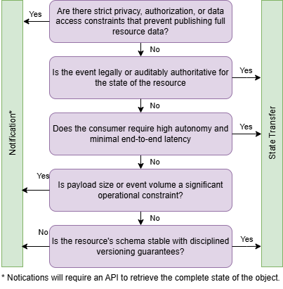

# Decision Tree: State Transfer versus Notification

## Introduction

The following decision tree helps determine whether an event should be implemented as a state transfer or a notification:
  

  

Legend:

| Decision criterion  | Architecture rationale |
| ------------------- |------------------------|
| Are there strict privacy, authorization, or data access constraints that prevent publishing full resource data?      | Notification events allow the producer to retain control over sensitive data while exposing detailed data through a protected API with proper access control. Broadcasting sensitive data may violate regulatory, contractual or policy requirements.     |
| Is the event legally or auditably authoritative for the state of the resource?      | Events that must serve as an authoritative audit or legal record should be self-contained. In some workflows you may also publish a notification for routing while using the state event as the authoritative payload.     |
| Does the consumer require high autonomy and minimal end to end latency?      | State Transfer eliminates runtime dependencies, enabling independent processing and the creation of local replicas of the resource state.     |
| Is payload size or event volume a significant operational constraint?      | Notification events minimize the amount of data transmitted and can enable the use of alternative transfer mechanisms (for example, managed file transfer (MFT), SFTP, or other file-based transports).     |
| Is the resource’s schema stable with disciplined versioning guarantees?      | Stable schemas reduce coupling risk when embedding full resource representations in events. Unstable schemas increase maintenance overhead.     |

